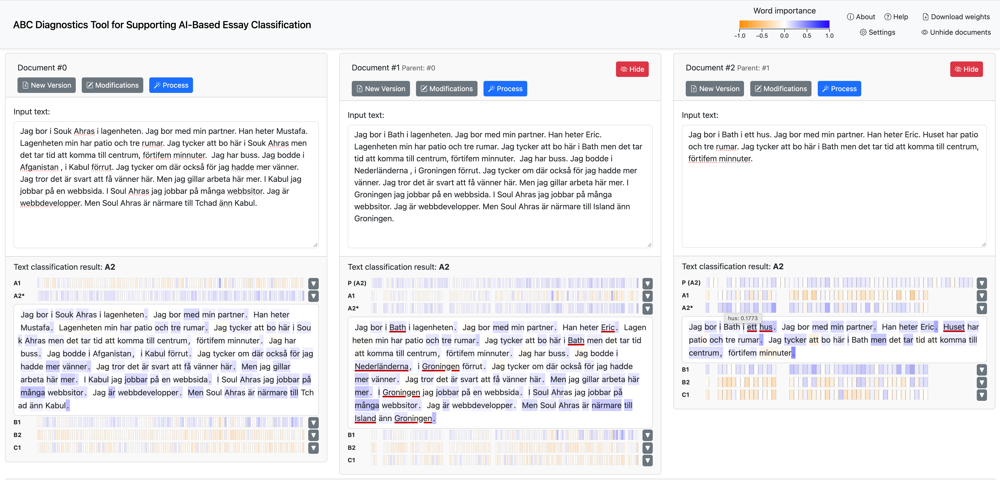

# ABC Diagnostics Tool for Supporting AI-Based Essay Classification



This tool is designed to support AI-based essay classification by providing transparency into how automated systems evaluate written text. It helps users understand how their writing is analyzed and graded by machine learning models — and crucially, *why* a particular grade was assigned.

The application classifies text into CEFR grade levels (A1, A2, B1, B2, C1) using a transformer-based language model. Beyond just producing a grade, it uses **feature attribution** to explain which individual words and tokens drove that decision. This makes the model's reasoning visible rather than treating it as a black box.

**For further instructions on the use of the tool, see the manual page (based on the instructions available within the web interface)**: [manual.md](docs/manual.md)

**Demo video**: [available as part of external supplementary material for the NLP4CALL 2026 paper](https://ivis.itn.liu.se/pubs/data/nlp4call26-munoz_sanchez/)


## Installation

The tool is implemented and tested with Python 3.11.14 (due to compatibility concerns for critical dependcies such as `captum` and `pytokenizations`, and their eventual dependencies, including specific versions of `numpy`).

Installing dependencies from `requirements.txt`:

`pip install -r requirements.txt`

A recommended approach would be to do that within a virtual environment created with `python3 -m venv`, `virtualenv`, or `conda`. For instance, using `virtualenv` and `python3.11`:

```
mkvirtualenv ABC-Diagnostics-env -p `which python3.11` 
python3 -m pip install --upgrade pip
pip install -r requirements.txt
```

Example using Conda environments: 
```
conda create -n ABC-Diagnostics-env python=3.11
conda install -n ABC-Diagnostics-env pip
conda activate ABC-Diagnostics-env
pip install -r requirements.txt
```

### Installation - Local BERT model

To be able to use a BERT classification model (https://huggingface.co/rimusa/CEFR_essay_classification-swedish-cased currently used for testing) locally, ensure that `huggingface-hub` is installed in the local (virtual) environment (should be already installed when using `requirements.txt` with `pip`), and run the following command:

```
hf download rimusa/CEFR_essay_classification-swedish-cased
```


## Usage
 
**Two** processes need to be launched at the moment (so you will probably need two terminal windows/tabs). Assuming the respective dependencies are met (e.g., using the virtual environment, as described above), navigate to the `ABC-Diagnostics-Tool` directory. 

**Remember to activate your virtual environment if needed**, e.g., `workon ABC-Diagnostics-env` or `conda activate ABC-Diagnostics-env`, for both terminal windows/tabs. 

For convenience, you may wish to launch two scripts (`run_01_model_api.sh` and `run_02_tool_web_server.sh`) in two terminal windows/tabs (if using Bash or similar shells on macOS/Unix-like systems). Otherwise, follow the instructions below.

 
### Usage - Local BERT model

Remember to install the requirements, navigate to the `ABC-Diagnostics-Tool` directory, and activate the virtual environment if needed (see above).
 
Launch `flask` for the model API backend (`ABC_bert_model_api_dev`) in a way similar to the VSCode example below under 'Development' (`PYTHONDONTWRITEBYTECODE` prevents the creation of temporary bytecode `.pyc` files). For instance (for macOS or Unix-like systems):
 
```
PYTHONPATH=src:$PYTHONPATH PYTHONDONTWRITEBYTECODE=1 flask --app bert_model_dev.ABC_bert_model_api_dev --debug run --port 5101
```
 
 
### Usage - Web-based tool

Launch `flask` for the tool backend (`ABC_Diagnostics_tool_web_server`) in a way similar to the VSCode example below under 'Development' (`PYTHONDONTWRITEBYTECODE` prevents the creation of temporary bytecode `.pyc` files). For instance (for macOS or Unix-like systems):
 
```
PYTHONPATH=src:$PYTHONPATH PYTHONDONTWRITEBYTECODE=1 flask --app ABC_Diagnostics_tool.ABC_Diagnostics_tool_web_server run --port 5100
```
 
**The web interface should then be available** at http://localhost:5100

Please note that when launching the tool for the first time in a new environment, establishing connection with HuggingFace and downloading the BERT model may take a while (and an error may be reported within the web-based tool interface if the BERT model API is not available yet). Please check the output for the local BERT model and try sending the processing request from the web tool again.

For a long-term deployment (e.g., on a server), using a proper application server / WSGI setup such as Gunicorn + Apache/nginx is recommended.

**For further instructions on the use of the tool, see the manual page (based on the instructions available within the web interface)**: [manual.md](docs/manual.md)


## Development

Most of the relevant code is located under `src/ABC_Diagnostics_tool`.

Currently developed using VSCode. The Python interpreter is selected from the respective virtual environment. To launch the application using Flask development server, the following entry in `tasks.json` is suggested for VSCode:

```
        {
            "label": "Launch ABC-Diagnostics-Tool web server",
            "type": "shell",
            "command": "{the path to flask on your machine, e.g., /Users/username/.virtualenvs/ABC-Diagnostics-env/bin/flask} --app ABC_Diagnostics_tool.ABC_Diagnostics_tool_web_server --debug run --port 5100",
            "options": {
                "cwd": "${workspaceFolder}/ABC-Diagnostics-Tool/",
                "env": {"PYTHONPATH": "${workspaceFolder}/ABC-Diagnostics-Tool/src:${PYTHONPATH}", "PYTHONDONTWRITEBYTECODE": "1"}
            },
            "isBackground": true,
            "problemMatcher": []
        }
```

or using Conda environment:
```
        {
            "label": "Launch ABC-Diagnostics-Tool web server (Conda)",
            "type": "shell",
            "command": "conda activate ABC-Diagnostics-env && flask --app ABC_Diagnostics_tool.ABC_Diagnostics_tool_web_server --debug run --port 5100",
            "options": {
                "cwd": "${workspaceFolder}/ABC-Diagnostics-Tool/",
                "env": {"PYTHONPATH": "${workspaceFolder}/ABC-Diagnostics-Tool/src;${PYTHONPATH}", "PYTHONDONTWRITEBYTECODE": "1"}
            },
            "isBackground": true,
            "problemMatcher": []
        }
```

Note: In "env" use `src;${PYTHONPATH}` for Windows and `src:${PYTHONPATH}` for macOS/Unix.


### Development - Local BERT model

A simple API to be used for local development purposes is being developed for this model (see the code under `src/bert_model_dev`), but in the long run, externally deployed BERT model will be used via an externally provided API. 

For the local simple API, the following entry in `tasks.json` is suggested for VSCode:

```
        {
            "label": "Launch ABC-Diagnostics-tool mock BERT API",
            "type": "shell",
            "command": "{the path to flask on your machine, e.g., /Users/username/.virtualenvs/ABC-Diagnostics-env/bin/flask} --app bert_model_dev.ABC_bert_model_api_dev --debug run --port 5101",
            "options": {
                "cwd": "${workspaceFolder}/ABC-Diagnostics-Tool/",
                "env": {"PYTHONPATH": "${workspaceFolder}/ABC-Diagnostics-Tool/src:${PYTHONPATH}", "PYTHONDONTWRITEBYTECODE": "1"}
            },
            "isBackground": true,
            "problemMatcher": []
        }
```

or using Conda environment:
```
        {
            "label": "Launch ABC-Diagnostics-tool mock BERT API",
            "type": "shell",
            "command": "conda activate ABC-Diagnostics-env && flask --app bert_model_dev.ABC_bert_model_api_dev --debug run --port 5101",
            "options": {
                "cwd": "${workspaceFolder}/ABC-Diagnostics-Tool/",
                "env": {"PYTHONPATH": "${workspaceFolder}/ABC-Diagnostics-Tool/src;${PYTHONPATH}", "PYTHONDONTWRITEBYTECODE": "1"}
            },
            "isBackground": true,
            "problemMatcher": []
        }
```

Once the API is launched (assuming port 5101), it is possible to test it by sending requests with `curl` from shell, for instance:

```
curl --json '{"texts": ["The first text", "Alice och Bob skriver ett projekt om för att undersöka stereotyper i språkmodellerna"]}' http://localhost:5101/get_text_classification_results
```


## Citation

If you are using this software in your research, please cite *the upcoming NLP4CALL 2026 paper (to be updated)*.


## Authors

- Project PI: Elena Volodina (Språkbanken, University of Gothenburg, Sweden)
- Researchers: Ricardo Muñoz Sánchez (Språkbanken, University of Gothenburg, Sweden)
- InfraVis: Kostiantyn Kucher and Filip Kayar (InfraVis, Linköping University, Sweden)


## Acknowledgments

The authors acknowledge support from InfraVis for providing visualization resources through the Swedish Research Council grant 2021-00181. 
